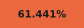
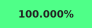
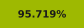
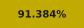
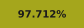

# saga-pc

<!-- matching-badge -->
<!-- /matching-badge --> 

<!-- mapping-badge -->

| Metric | Coverage&nbsp;&nbsp;&nbsp;&nbsp;&nbsp;&nbsp;&nbsp;&nbsp;&nbsp;&nbsp; |
| --- | --- |
| **Code** | |
| &nbsp;&nbsp;↳ **Fuzzy match**: objdiff's fuzzy match over all original code, by size ([details](docs/mapping-status.md#what-the-readme-numbers-measure)). |  |
| &nbsp;&nbsp;↳ **Exact match**: byte-identical code, with the padding after it. |  |
| &nbsp;&nbsp;↳ **Mapped**: known code, with the padding between functions (3.3%). |  |
| &nbsp;&nbsp;&nbsp;&nbsp;&nbsp;&nbsp;↳ **Named**: mapped functions with real names; 1.7% are `fun_XXXXXXXX`. |  |
| **Data** | |
| &nbsp;&nbsp;↳ **Mapped file-backed**: known data in the executable, with its padding. |  |
| &nbsp;&nbsp;&nbsp;&nbsp;&nbsp;&nbsp;↳ **Reproduced**: file-backed data we define byte-exactly ([details](docs/mapping-status.md#reproduced-data)). |  |
| &nbsp;&nbsp;↳ **Mapped zero-fill/BSS**: known zero-initialized storage. |  |

<!-- /mapping-badge -->

What the mapping numbers count, and every byte they do not yet cover, is in
[docs/mapping-status.md](docs/mapping-status.md).

**saga-pc** is a matching decompilation of the GOG PC release of
*LEGO Star Wars: The Complete Saga*: C/C++ source that compiles with the original
compiler (MSVC 2005) into the same x86 code as the retail executable. Most game
code comes from the [Android decompilation](https://github.com/opensagadev/saga)
and is adapted to the PC build.

See [CONTRIBUTING.md](CONTRIBUTING.md) for setup, the workflow and the automated
source-shape search (`tools/permute.py`).

`make Matching` (the default) builds the matching executable. `make Debug`
builds a separate executable with diagnostics and symbols. Both share the same
game behavior; build-kind differences are strictly diagnostics only. See
[build kinds and logging](CONTRIBUTING.md#build-kinds-and-logging).

## License

Source is distributed under [GNU GPL version 3](LICENSE). This independent
project does not distribute the original game or its assets, which remain the
property of their respective owners.

Ogg/Vorbis sources are fetched into ignored `lib/ogg-vorbis/` during the build;
see [dependency setup and provenance](DEPENDENCIES.md).
